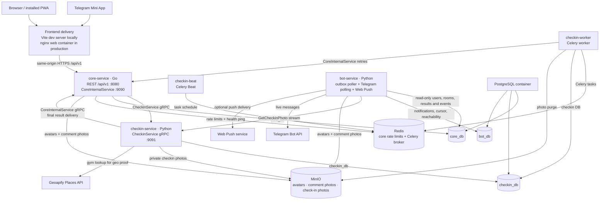

# BuddyGym

BuddyGym is a Telegram Mini App and installable PWA for small workout rooms. Members log a
workout with a photo for peer voting or with a verified gym location. Approved workouts feed
progress, achievements, statuses, comments and profile themes.

The product is mobile-first. Telegram is the primary launch surface; the browser/PWA uses the
same account and the same rooms and progress.

## Architecture

The runtime has one public application boundary. The frontend never calls the check-in service,
Postgres, Redis or MinIO directly.



The graph describes the services and data paths that are present in Compose. `checkin-worker`
and `checkin-beat` use the same image as `checkin-service`; they are separate processes. The
`bot` process combines outbox polling, reminder scheduling and optional Telegram long polling.

### Runtime components

| Component | Responsibility | Boundary |
| --- | --- | --- |
| `frontend` | React UI, Telegram SDK integration, PWA shell, auth client, photo preprocessing and Web Push subscription | Calls core REST only |
| `core` | Telegram/web auth, users, accounts, rooms, membership, freezes, rewards, comments, push subscriptions and REST API | REST `:8080`; internal gRPC `:9090` |
| `checkin` | Photo/geo proof lifecycle, votes, quorum, expiration, private photo streaming and result delivery state | Internal gRPC `:9091` |
| `checkin-worker` | Runs expiration, result-delivery and photo-purge tasks | Celery via Redis |
| `checkin-beat` | Schedules the three check-in background tasks | Celery via Redis |
| `bot` | Reads core events, builds recipient-specific cards and sends Telegram/Web Push notifications | SQL read-only access to `core_db`; writes `bot_db` |
| `web` | Production-only nginx container serving the built frontend and proxying `/api/` to core | Publishes `127.0.0.1:18080` by default |

`checkin-migrate` and `bot-migrate` are one-shot migration containers. A successful `exited (0)`
state is expected for them; they are not long-running application services.

### Data ownership

| Store | Owner | Contents |
| --- | --- | --- |
| `core_db` | `core-service` | Users, Telegram identities, web credentials/sessions, rooms, memberships, freezes, check-in results, comments, push subscriptions and the notification outbox `events` |
| `checkin_db` | `checkin-service` | Check-ins, votes, finalization timestamps, result-delivery retry state and photo-retention state |
| `bot_db` | `bot-service` | Outbox cursor, one notification row per `(event, recipient, kind)` and Telegram reachability |
| MinIO `avatars` | core/bot | Mirrored user avatars and room avatars |
| MinIO `comment-photos` | core/bot | Private comment attachments |
| MinIO `checkin-photos` | checkin/bot | Private workout proof objects |
| Redis | core/check-in runtime | Core fixed-window rate-limit keys and the Celery broker; it is not the source of truth for domain data |

The three PostgreSQL databases live in one local Compose PostgreSQL container but have separate
databases and migration chains. The services do not share ORM models or write each other's
database.

### Shared contracts

The source contracts are in [`proto/buddygym/v1`](proto/buddygym/v1):

- `CheckinService` is implemented by Python and called by Go as the frontend-facing proxy;
- `CoreInternalService` is implemented by Go and called by Python when a check-in reaches a
  final status;
- Go stubs are generated into `core-service/internal/pb`;
- Python stubs are generated into `checkin-service/src/pb` and `bot-service/src/pb`.

The frontend does not import protobuf code. Its public contract is the core REST API documented
by Swagger.

## User flows

### Photo check-in

1. The frontend re-encodes the selected image as JPEG, removes EXIF metadata and sends
   `POST /api/v1/checkins` as multipart form data.
2. Core authenticates the user, verifies membership in every target room, takes each room's
   `votes_required` value and forwards one `CreateCheckin` RPC. A request may target up to 20
   rooms and the photo is capped at 10 MiB.
3. Check-in validates the bytes again, uploads the object once and creates one independent
   pending check-in row per room. The rows share one `photo_key`, so one workout does not create
   duplicate objects.
4. Room members vote through core. Check-in stores one vote per member, allows a pending vote to
   be changed, and finalizes independently for each room when its quorum is reached.
5. Check-in immediately attempts `ApplyCheckinResult`. If core is temporarily unavailable, the
   result stays in `checkin_db` and the Celery delivery task retries it. Core applies the result
   idempotently, updates progress/rewards and inserts an outbox event.
6. The bot polls the outbox, expands the event into recipient-specific notifications and stores
   delivery state in `bot_db` before sending anything.

### Geo check-in

The frontend sends the user's Telegram location as JSON instead of a photo. Check-in requires a
finite location fix with accuracy of 50 metres or better, asks Geoapify for `sport.fitness`
places within a 150 metre search radius and accepts the proof only when a gym is within 50
metres. A successful geo check-in is approved immediately and has no photo-retention lifecycle.
`GEOAPIFY_API_KEY` is required for this path.

### Private photos

MinIO is private. Core checks room membership before opening a check-in photo and streams the
bytes through `GET /api/v1/checkins/{id}/photo`; the frontend turns the authenticated response
into a blob URL. The bot reads check-in photos through the same internal gRPC stream and reads
avatars/comment photos from their private MinIO buckets. No presigned or public check-in URL is
part of the contract.

Photo proof objects are retained for 14 days. The check-in purge task marks old rows and deletes
a shared object only after every check-in that references it is past its retention window.

## HTTP API

The public API is rooted at `/api/v1` and all routes except auth, health and Swagger require a
Bearer JWT. The main route groups are:

| Area | Routes |
| --- | --- |
| Auth | `/auth/telegram`, `/auth/register`, `/auth/login`, `/auth/refresh`, `/auth/logout` |
| Account | `/me`, credentials, Telegram linking, avatars, notification preferences and push subscriptions |
| Users | `/users/{id}`, `/users/{id}/avatar` |
| Rooms | create/list/open/get/update/delete, join/leave, membership, freezes and room avatars |
| Check-ins | create, room feed, private photo, vote, tagged buddies and comments with photos/replies/likes |
| Operations | `GET /health` and `/docs/` |

Health is `GET /api/v1/health`. It pings Postgres and Redis and returns `503` with
`status: degraded` if either dependency is unavailable. Swagger UI is available at
`http://localhost:8080/api/v1/docs/` when the local core port is exposed.

Authentication supports two entry points for one account:

- Telegram Mini App `initData` is verified against `BOT_TOKEN` and returns a short-lived JWT;
- browser registration/login returns a JWT plus a rotating `Secure`, `HttpOnly`, `SameSite=Lax`
  refresh session. The frontend keeps access tokens in memory and retries one expired request
  after rotating the refresh session.

Core rate limits are backed by Redis: 10 auth requests per minute per client IP, 120 authenticated
API requests per minute per user and 20 check-in creations per hour per user.

## Repository layout

The root repository contains the Go service, notification bot, shared protobuf source and the
Compose/deployment files. The frontend and check-in service are separate git repositories that
are normally cloned into the ignored paths shown below for local integration.

```text
BuddyGym/
├── core-service/       Go REST API and CoreInternalService
├── bot-service/        Python notification worker and Telegram bot
├── proto/              shared gRPC source contracts
├── frontend/           BuddyGym-Frontend repository, ignored by this repo
├── checkin-service/    BuddyGym-CheckIn repository, ignored by this repo
├── deploy/              nginx and PostgreSQL initialization
└── docker-compose*.yml  local stack and production overlay
```

Repositories:

- [BuddyGym-Frontend](https://github.com/kosttiik/BuddyGym-Frontend)
- [BuddyGym-CheckIn](https://github.com/R3al1ty1/BuddyGym-CheckIn)
- [`bot-service/README.md`](bot-service/README.md)

## Quick start

From this repository, place the frontend and check-in repositories at `./frontend` and
`./checkin-service`, then configure the required secrets:

```bash
cp .env.example .env
# set BOT_TOKEN and a random JWT_SECRET of at least 32 bytes
docker compose up -d --build
docker compose ps
curl -i http://localhost:8080/api/v1/health
```

The local override is loaded automatically and exposes Postgres, Redis, MinIO, core HTTP/gRPC
and check-in gRPC for development. The check-in and bot migration services should finish with
exit code 0. The local backend stack does not build the frontend; run the Vite app separately:

```bash
cd frontend
npm ci
npm run dev
```

The Vite server proxies `/api` to `http://localhost:8080`. For UI-only work, use MSW instead:

```bash
npm run msw:init   # once, if public/mockServiceWorker.js is missing
npm run dev:mock
```

Use `http://localhost:5173/?mockAuth=web` for the browser auth screen and add `&mockPwa=1` to
force the install prompt in mock mode. Real browser refresh cookies are `Secure`, so use the
same-origin HTTPS production path for a realistic web-auth session; Telegram and mock auth do
not need that cookie.

## Development

Core and bot checks run from this repository:

```bash
go -C core-service vet ./...
go -C core-service test ./...
go -C core-service build ./cmd/core

cd bot-service
uv sync --locked
make lint
make test
make test-integration     # requires Docker
```

Frontend checks run in `frontend`:

```bash
cd frontend
npm ci
npm run lint
npm run typecheck
npm run test
npm run build
```

Check-in checks run in `checkin-service`:

```bash
cd ../checkin-service
uv sync --locked
make PROTO_DIR=../proto lint
make PROTO_DIR=../proto format       # ruff format check
make PROTO_DIR=../proto test
make PROTO_DIR=../proto test-integration  # Testcontainers
```

Regenerate contracts only after changing the shared `.proto` files:

```bash
make proto
make -C bot-service proto-py
make -C checkin-service PROTO_DIR=../proto proto-py
```

The explicit `PROTO_DIR` override is needed for the nested checkout layout used by this
workspace. A separately cloned check-in repository may use its own sibling-layout Makefile
default.

Regenerate Swagger from the root when changing REST handlers or annotations:

```bash
make swagger
git diff --exit-code -- core-service/docs
```

The root CI checks Go vet/tests/build, Swagger freshness, bot lint/tests/integration tests and
both Docker builds. The frontend and check-in repositories have their own CI workflows for
Node/Python lint, tests, integration tests and Docker builds.

## Deployment

The base Compose file is the local/backend stack. The production overlay adds the built frontend
and nginx:

```bash
cp deploy/.env.prod.example .env
docker compose -f docker-compose.yml -f docker-compose.prod.yml up -d --build
curl -s -o /dev/null -w '%{http_code}\n' http://127.0.0.1:18080/api/v1/health
```

The overlay publishes only `127.0.0.1:18080`. nginx serves the frontend and proxies `/api/` to
core; Postgres, Redis, MinIO, core and check-in remain on the Compose network. Put TLS and the
public reverse proxy in front of that loopback port. The checked-in deployment configuration is
shaped for a Synology host where DSM owns ports 80/443 and its reverse proxy terminates TLS.

Do not expose the internal gRPC ports on a public interface. The Compose gRPC channels are
plaintext and rely on network isolation; `docker-compose.override.yml` publishes them only as a
development convenience.

To stop local services while keeping volumes:

```bash
docker compose down
```

`docker compose down -v` also deletes the local PostgreSQL and MinIO volumes.

## MVP boundaries

The current runtime intentionally has no Kafka, Kubernetes, saga coordinator, ML photo judge,
anti-cheat service, payments, subscriptions or cross-room competitive leaderboard. Check-in
verification is limited to peer votes or the Geoapify-backed gym proximity path.
