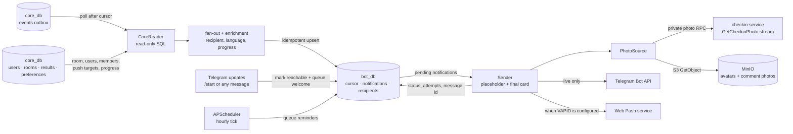

# bot-service

`bot-service` is BuddyGym's notification worker. It reads the core outbox and the read-only
domain data needed to personalize a notification, stores durable delivery rows in `bot_db`,
renders branded Pillow cards and sends them through Telegram and, optionally, Web Push.

It is not an HTTP API and it does not own BuddyGym users, rooms or check-in state. In Compose it
runs as one long-lived process from `src.main`; database migration runs separately in
`bot-migrate`.

## Architecture



The polling loop runs every `POLL_INTERVAL_SECONDS` (5 seconds by default). The same process
also runs the reminder scheduler and starts aiogram Telegram long polling only when
`BOT_MODE=live` and `BOT_TOKEN` is set. In `dry-run` mode it still consumes and renders events,
but never contacts Telegram.

## Data boundaries

- `core_db` is read-only from this service. The reader queries `events`, users, rooms,
  memberships, check-in results, notification preferences and Web Push subscriptions.
- `bot_db` is owned by this service. It stores the outbox cursor, pending/sent/failed
  notifications and whether Telegram can reach a user.
- Check-in proof photos are streamed from `checkin-service` over `GetCheckinPhoto`; avatars and
  comment photos are read from their private MinIO buckets.
- The bot never exposes a photo URL to Telegram. It downloads bytes, composes one card and sends
  the rendered image.

The unique key `(event_id, chat_id, kind)` makes ingestion idempotent. A restart can read an
event again without creating a second card for the same recipient and notification kind.

## Notification kinds

| Source or trigger | Recipient and card |
| --- | --- |
| `comment.created` | The check-in owner receives `comment`; a parent-comment author receives `reply` when applicable |
| `checkin.created` | Other room members receive `vote_request`; an already approved check-in creates no vote request |
| `checkin.approved` / `checkin.rejected` | The author receives the verdict; each newly granted achievement becomes an `achievement` card |
| `buddy.credited` | Each tagged buddy receives `buddy_credited` after the source workout is approved |
| `member.joined` / `member.left` | Other room members receive the corresponding membership card |
| `freeze.scheduled` / `freeze.canceled` | Other room members receive the corresponding freeze card |
| Period reminder | Members behind their goal and near the end of a period receive `reminder` |
| Backfill or first run | Stale pending rows are folded into one per-chat `digest` card |
| Telegram `/start` | A one-time `welcome` card is queued and unreachable deliveries are reopened |

The event names above are emitted by core or generated by the bot's reminder/backfill/welcome
paths. Card kinds such as `vote_last_call`, `streak_at_risk` and `period_summary` have rendering
support but are not currently produced by the active fan-out or scheduler.

## Delivery behavior

1. `ingest()` reads events after the cursor, resolves the room and recipients, enriches payloads
   with the recipient's language, member goal and sport, then upserts rows in `bot_db`.
2. Events older than `DIGEST_AFTER_HOURS` (24 by default) are marked skipped and summarized into
   one digest per chat, so a new deployment does not send a historical burst.
3. Telegram live delivery first sends a branded placeholder, renders/fetches the final card and
   edits the message in place. The global limiter defaults to 25 messages per second and a
   per-chat lock spaces messages by one second.
4. A Telegram `Forbidden` response marks the recipient unreachable. A future `/start` or incoming
   text message marks the recipient reachable and requeues those notifications.
5. Telegram rate-limit responses remain pending and are retried until `MAX_SEND_ATTEMPTS` (5 by
   default). Other send errors are recorded as failed; the placeholder is considered delivered
   even if rendering or the later media edit fails.
6. When `VAPID_PRIVATE_KEY` is configured, Web Push is attempted for the user's stored browser
   subscriptions. The matching public key is served by core at `/api/v1/push/public-key`.

## Modes and configuration

`BOT_MODE=dry-run` is the default. Each notification writes a PNG and a JSON payload/caption to
`BOT_DRY_RUN_DIR` (default `out`) and sends nothing to Telegram. `BOT_MODE=live` requires a bot
token and enables Telegram long polling plus outgoing messages.

The Compose file supplies the database DSNs and internal addresses. When running the process
outside Compose, the important settings are:

| Variable | Purpose |
| --- | --- |
| `BOT_MODE`, `BOT_TOKEN`, `BOT_USERNAME`, `MINI_APP_SHORT_NAME` | Telegram mode and links |
| `BOT_DB_DSN`, `CORE_DB_DSN` | The owned database and read-only core database |
| `CHECKIN_GRPC_ADDR` | Check-in photo stream, normally `checkin:9091` |
| `S3_ENDPOINT`, `S3_ACCESS_KEY`, `S3_SECRET_KEY` | MinIO access for avatars and comment photos |
| `S3_AVATAR_BUCKET`, `S3_COMMENT_BUCKET` | Bucket names |
| `VAPID_PRIVATE_KEY`, `VAPID_SUBJECT`, `WEB_APP_URL` | Optional Web Push delivery |
| `POLL_INTERVAL_SECONDS`, `EVENT_BATCH_SIZE`, `MAX_SEND_ATTEMPTS` | Polling and delivery tuning |
| `DIGEST_AFTER_HOURS`, `REMINDER_HOURS_BEFORE`, `REMINDER_LOCAL_HOUR` | Backfill and reminder policy |

## Development

From this directory:

```bash
uv sync --locked
make lint
make test                 # unit tests; integration tests are excluded by default
make test-integration     # Testcontainers/PostgreSQL tests, requires Docker
make dry-run
```

The generated check-in protobuf files are committed. Regenerate them after changing the shared
contract:

```bash
make proto-py
```

Run the migration against the configured `BOT_DB_DSN` with:

```bash
make migrate
```

The service is normally started by the root Compose project, which also starts PostgreSQL,
MinIO, core, check-in and the check-in workers. To inspect rendered dry-run cards, look in
`bot-service/out/`; that directory is local-only.
